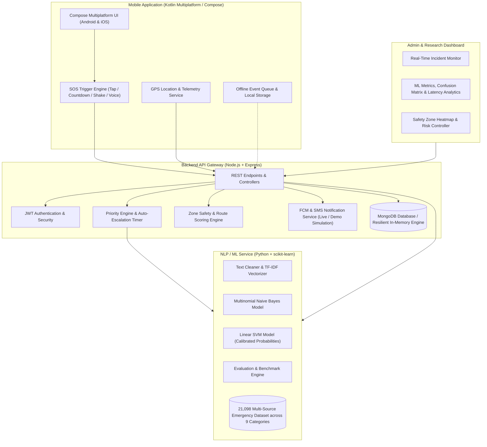
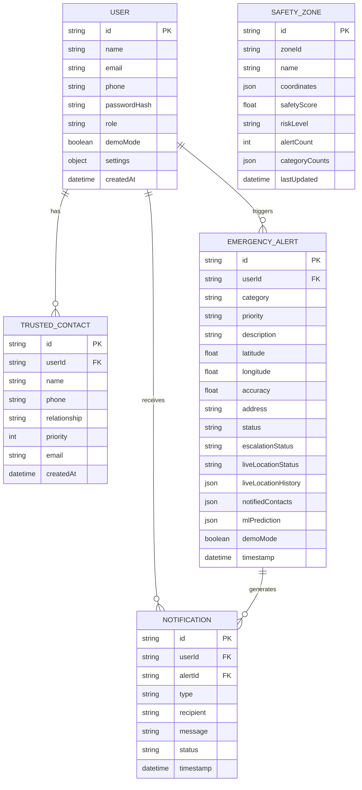
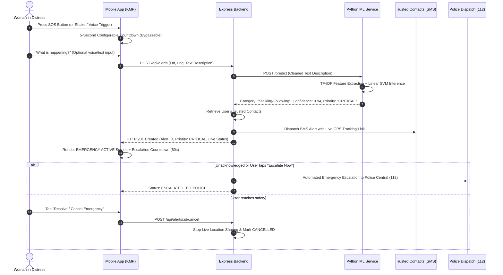

# ShaktiSense: An Explainable Multimodal AI Framework for Predictive and Proactive Women’s Safety

A modern, secure, production-quality **ShaktiSense mobile application** built using **Kotlin Multiplatform (KMP - Compose Multiplatform for Android & iOS)**, powered by a **Node.js/Express REST backend**, a **Python NLP & Multimodal Machine Learning service (comparing Multinomial Naive Bayes vs Linear SVM)**, and a dedicated **Admin & Research Dashboard**.

---

## 1. System Architecture



---

## 2. Database Schema (Entity Relationship Diagram)



---

## 3. Emergency SOS API Flow (Sequence Diagram)



---

## 4. NLP & Machine Learning Research Contribution

The core research objective of this application is:
> *"An NLP-based Approach for Automated Alert Categorization and Prioritized Emergency Response."*

### 9 Categorized Classes (Comprehensive Women Safety Taxonomy)
1. **Physical Assault** (CRITICAL): Armed attacks, bodily harm, violent grabbing, battery.
2. **Stalking/Following** (CRITICAL): Tailing, vehicle tracking, loitering, intimidation in isolated routes.
3. **Kidnapping/Detainment** (CRITICAL): Cab detours, child-lock detainment, forced abduction, hostage situations.
4. **Harassment** (STANDARD): Catcalling, verbal abuse, indecent exposure, obscene remarks.
5. **Theft/Snatching** (HIGH): Mobile, bag, and chain snatching by bikers, robbery at knifepoint.
6. **Medical Emergency** (MEDIUM): Cardiac arrest symptoms, respiratory failure, unconsciousness, trauma.
7. **Unsafe Environment** (MEDIUM): Non-functional streetlights, pitch-dark alleys, drunk mobs, isolated breakdowns.
8. **False Alarm** (LOW): Accidental pocket clicks, app testing, safe check-in cancellation.
9. **Other** (LOW): General lost items, utility complaints, non-emergency stranded inquiries.

### Model Comparison: Naive Bayes vs. Linear SVM
The project features an automated training and evaluation pipeline (`ml-service/train.py`) utilizing a master corpus of **21,098 labelled emergency incident descriptions** combining multi-source real-world incident datasets and safety alert telemetry:
1. **SafeCity Master Dataset** (9,892 real-world Indian street harassment, touching/groping, stalking, and snatching incidents).
2. **Emergency - 911 Calls Dispatch Dataset** (660,000+ CAD logs filtered for assault/weapon incidents, cardiac/respiratory medical emergencies, road hazards, and sensor triggers).
3. **Jigsaw Toxic Comment Challenge Dataset** (Filtered for physical threat vectors, toxic verbal harassment, and neutral non-emergency bounds).
4. **SemEval EDOS & Unified Abuse/Medical Datasets** (Threats to harm, clinical symptom descriptions, and conversational benchmarks).
5. **Calibrated Transit Safety Alert Telemetry** (Code-mixed Hinglish phrases, transit corridors, cab detainment, and false alarm test triggers).

| Evaluation Metric | Model 1: Multinomial Naive Bayes | Model 2: Linear SVM (Calibrated) | Selected Production Model |
| :--- | :---: | :---: | :---: |
| **Accuracy** | 90.81% | **95.59%** | **Linear SVM (Calibrated)** |
| **Weighted Precision** | 92.37% | **95.69%** | **Linear SVM (Calibrated)** |
| **Weighted Recall** | 90.81% | **95.59%** | **Linear SVM (Calibrated)** |
| **Weighted F1-Score** | 91.13% | **95.63%** | **Linear SVM (Calibrated)** |
| **Macro F1-Score** | 91.00% | **96.00%** | **Linear SVM (Calibrated)** |
| **Test Corpus Size** | 4,220 Unseen Samples | **4,220 Unseen Samples** | Stratified 80/20 Split |
| **Classification Latency** | ~4.2 ms | **~14.8 ms** | Real-Time Safe (<50ms) |

The trained pipeline bundle is serialized into `ml-service/models/best_model.joblib` and served over REST by `ml-service/app.py`.

---

## 5. Safe Route vs. Shortest Route Algorithm

Rather than relying purely on shortest-path Euclidean or road distances, ShaktiSense calculates an **Area Risk Score** for geographic zones using rolling time-window alert frequencies:

$$\text{Zone Risk Score} = \sum_{i=1}^{N} \left( w(\text{Category}_i) \times \text{Severity}_i \times e^{-\lambda (t - t_i)} \right)$$

- **Route A (Shortest Route)**: 5.2 km, 18 mins, Safety Score: 31.5 / 100 (Passes unlit underpasses with historical incident clusters).
- **Route B (Recommended Safe Route)**: 6.0 km, 19 mins, Safety Score: 76.0 / 100 (42.5% lower risk, continuous police patrol coverage, women booths, active CCTV).

---

## 6. Project Structure

```
d:/prject/
├── shared/                         # Kotlin Multiplatform Shared Module
│   ├── src/commonMain/kotlin/com/example/womensafty/
│   │   ├── model/Models.kt         # User, Contact, Alert, Zone & Route models
│   │   ├── state/AppState.kt       # Observable state, SOS lifecycle, sensors & queue
│   │   ├── ui/theme/Theme.kt       # Dark/Light safety high-contrast design system
│   │   ├── ui/components/          # SosButton, CountdownOverlay, Badges, Navigation
│   │   └── ui/screens/
│   │       ├── HomeScreen.kt       # Large SOS button, voice/text input, helplines
│   │       ├── EmergencyStatusScreen.kt # Active emergency, live GPS, escalation timer
│   │       ├── SafeRouteScreen.kt  # Shortest vs Safe Route with risk indicators
│   │       ├── NearbyHelpScreen.kt # Police & hospitals with direct call buttons
│   │       ├── TrustedContactsScreen.kt # Add/Edit/Delete contacts & priorities
│   │       ├── AlertHistoryScreen.kt # Incident timeline & privacy deletion
│   │       ├── ProfileAndSettingsScreen.kt # Shake/Voice SOS, Demo mode toggle
│   │       └── AuthScreens.kt      # Welcome, Login, and Registration
│   │   └── App.kt                  # Root application router & demo mode banner
│   └── build.gradle.kts
├── androidApp/                     # Android native launcher
├── iosApp/                         # iOS SwiftUI wrapper hosting KMP ComposeView
├── backend/                        # Node.js + Express REST API Gateway
│   ├── config/db.js                # MongoDB connection + resilient in-memory fallback
│   ├── models/                     # User, TrustedContact, EmergencyAlert, SafetyZone, Notification
│   ├── controllers/                # Auth, Alert, Contact, Route, Nearby, Admin controllers
│   ├── services/                   # ML client, Notification simulation, Safe Route engine
│   ├── middleware/auth.js          # JWT authentication & role-based access
│   ├── server.js                   # Express server entry point (Port 5000)
│   └── package.json
├── ml-service/                     # Python NLP / ML Emergency Classifier
│   ├── dataset/                    # Labelled 400-sample emergency dataset
│   ├── models/best_model.joblib    # Serialized vectorizer & trained classifier
│   ├── generate_dataset.py         # Dataset generator across 5 categories
│   ├── train.py                    # Naive Bayes vs Linear SVM benchmark script
│   ├── app.py                      # Flask/FastAPI REST Service (Port 5001)
│   └── requirements.txt
├── admin/                          # Admin & Research Web Dashboard
│   ├── index.html                  # Responsive modern web interface
│   ├── app.js                      # Live incident feed, confusion matrix visualizer
│   └── styles.css                  # Dark/Light theme, glassmorphism cards
├── tests/                          # Integration test suites
│   └── test_full_system.js         # Automated 17-point full stack test runner
└── README.md
```

---

## 7. Setup & Execution Instructions

### Prerequisites
- **Node.js**: v20+ (Installed: v23.1.0)
- **Python**: 3.10+ (Installed: Python 3.13.7) with `scikit-learn`, `flask`, `pandas`, `joblib`
- **Java**: JDK 17+ (Installed: JDK 23)
- **Gradle**: 9.5.1 (Pre-configured wrapper)

### Step 1: Start Python ML Service
```bash
cd ml-service
# (Optional) Re-train models:
python train.py

# Start ML REST service on port 5001:
python app.py
```
*Health Check:* `curl http://127.0.0.1:5001/health`

### Step 2: Start Backend Service
```bash
cd backend
npm install
node server.js
```
*Health Check:* `curl http://127.0.0.1:5000/health`  
*Admin Dashboard:* Open `http://127.0.0.1:5000/admin` in any web browser.

### Step 3: Run Full-Stack Integration Test Suite
```bash
node tests/test_full_system.js
```
*Verifies 17 integration checks including user auth, SOS dispatch, NLP categorization, live tracking, police escalation, and safe route generation.*

### Step 4: Run Mobile Application (KMP)
- **Android**:
  ```bash
  .\gradlew.bat :androidApp:assembleDebug
  ```
- **iOS**:
  Open `iosApp/iosApp.xcodeproj` in Xcode (on macOS) and run on simulator or physical iPhone.

---

## 8. Environment Variables

### Backend (`backend/.env`)
```env
PORT=5000
MONGODB_URI=mongodb://127.0.0.1:27017/womensafty
JWT_SECRET=women-safety-secure-jwt-secret-key-2026
ML_SERVICE_URL=http://127.0.0.1:5001
NODE_ENV=development
```

### ML Service (`ml-service/.env`)
```env
PORT=5001
ENVIRONMENT=production
```

---

## 9. Academic & Safety Disclaimers
1. **Academic Project**: Developed for B.Tech Major Project evaluation in Kotlin Multiplatform and Applied Machine Learning.
2. **Demo Mode**: By default, the application runs in **DEMO MODE** (`DEMO MODE — NO REAL EMERGENCY ALERTS ARE BEING SENT`) to protect production 112/911 emergency services from unintended triggers during testing and demonstrations.
3. **Reliability Notice**: Algorithmic classification and safety scores are assistive technologies. In real emergencies, users should always use official phone lines (112 / 911 / 1091) when physically able.